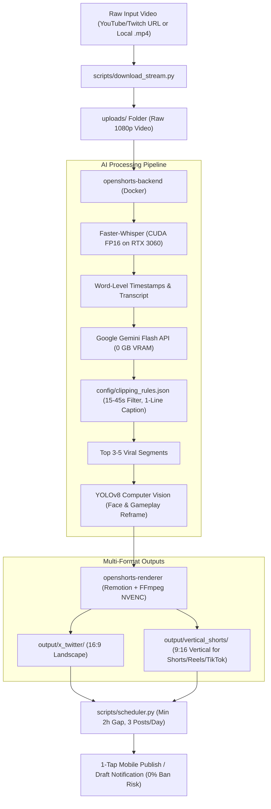

# System Architecture & Component Interconnections

This document provides a clean, detailed breakdown of how every file, configuration, and service in **OpenShorts RTX Clipper** links together.

---

## 1. High-Level Data Flow



---

## 2. File & Service Interconnection Map

| File Path | Role | Connected To |
| :--- | :--- | :--- |
| **`.env.example` / `.env`** | Central configuration for hardware, API keys, and pipeline filters. | Loaded by `docker-compose.yml`, `scripts/scheduler.py`, and `backend`. |
| **`docker-compose.yml`** | Defines Docker containers (`backend` on port 5175 and `render-service`). | Reads environment variables from `.env` and mounts `uploads/`, `output/`. |
| **`docker-compose.override.yml`** | Grants GPU hardware pass-through (`capabilities: [gpu, video]`). | Applied automatically by Docker Compose to allocate RTX 3060 to CUDA. |
| **`config/clipping_rules.json`** | Defines hard constraints: 15–45s duration, 16:9 for X, 9:16 for Shorts, 1-line caption. | Consumed by `scripts/scheduler.py` and the moment selection prompt. |
| **`scripts/setup_windows.ps1`** | Automated setup for Windows 11 / Asus TUF A15. | Verifies `nvidia-smi`, Docker Desktop, creates directories, copies `.env`. |
| **`scripts/setup_linux.sh`** | Automated setup for Ubuntu / Linux / WSL2. | Checks CUDA driver, creates directories, sets directory permissions. |
| **`scripts/download_stream.py`** | Helper to download full streams via `yt-dlp`. | Saves downloaded `.mp4` into the `./uploads` directory for processing. |
| **`scripts/scheduler.py`** | Computes daily publishing slots with a strict 2-hour minimum spacing. | Reads `config/clipping_rules.json` and outputs a publishing queue. |
| **`templates/viral_hooks.json`** | High-retention hooks and hashtag bundles for Gaming & GTA/PUBG. | Used for captions and titles during final video export. |
| **`docs/`** | Architectural runbooks, safety guidelines, and niche playbooks. | Referenced by human creators and autonomous AI agents. |

---

## 3. GPU VRAM Allocation Budget (Asus TUF A15 RTX 3060 - 6GB Total)

To prevent CUDA Out-Of-Memory (OOM) crashes on 6GB laptops, memory is allocated as follows:

```
Total RTX 3060 Laptop VRAM: 6.0 GB
─────────────────────────────────────────────
[ Faster-Whisper large-v3-turbo (FP16) ] : ~1.8 GB
[ YOLOv8 Face/Subject Tracking ]         : ~0.8 GB
[ FFmpeg NVENC Video Encoding Buffer ]   : ~0.6 GB
[ Windows / Display System Overhead ]    : ~1.2 GB
─────────────────────────────────────────────
Remaining Safety Buffer                  : ~1.6 GB (Headroom)
[ Google Gemini Flash (Cloud Offload) ]  :  0.0 GB (Zero GPU VRAM)
```

By offloading the 7B LLM reasoning to Google Gemini Flash API, the system runs safely inside 6GB VRAM without thermal throttling or memory spillover.
